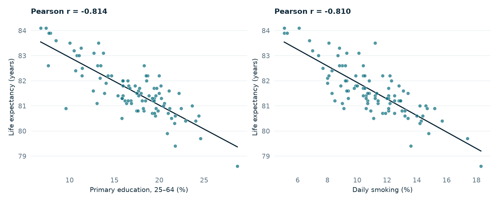

# Danish Health & Life Expectancy

**A municipality-level atlas of geographical health inequality in Denmark**

This independent public-health data and portfolio project brings together official Danish socioeconomic, health-profile and life-expectancy data. It examines how social conditions and health behaviours are associated with differences in population health across Denmark’s 98 municipalities.

## [Open the live dashboard →](https://danish-health-inequality-atlas.streamlit.app)

The dashboard presents the validated analysis through interactive comparisons, municipality profiles, statistical models and bilingual reports. Results describe municipality-level associations and should not be interpreted as individual or causal effects.

## Research question

> **Which socioeconomic conditions and health-behaviour indicators are associated with geographical differences in life expectancy across Danish municipalities?**

## Data sources

| Official source | Measures | Period |
| --- | --- | --- |
| Statistics Denmark: [INDKP106](https://www.statbank.dk/INDKP106) | Mean personal disposable income | 2024 |
| Statistics Denmark: [HFUDD11](https://www.statbank.dk/HFUDD11) and [FOLK1A](https://www.statbank.dk/FOLK1A) | Education, population and age structure | 2024 |
| [Danish National Health Profile](https://www.danskernessundhed.dk/) | Smoking, obesity, physical activity, alcohol, self-rated health and mental health | 2025 |
| Statistics Denmark: [HISBK](https://www.statbank.dk/HISBK) | Period life expectancy at birth, total/male/female | 2021–2025 |

The municipality master table contains all **98 municipalities**. Life expectancy is published for **94**; Ærø, Fanø, Samsø and Læsø are withheld by the source because the estimates are too uncertain. No withheld values are imputed.

## Analytical approach

The project combines descriptive statistics with Pearson and Spearman correlations, Benjamini–Hochberg false-discovery-rate correction, prespecified OLS models, HC3 robust standard errors, standardized coefficients, VIF diagnostics, PCA, k-means clustering, Cook’s distance, sensitivity analysis and leave-one-out validation.

Primary analyses use saved and validated outputs; the dashboard does not refit the models at runtime.

## Key validated findings

- **Education and smoking show the strongest negative simple associations.** The share with primary education is associated with life expectancy at **r = −0.814**, and daily smoking at **r = −0.810**.
- **Income is positively associated with life expectancy.** Mean disposable income has a Pearson correlation of **r = +0.709**.
- **Poor self-rated health is closely related to lower life expectancy.** The municipality-level correlation is **r = −0.763**.
- **Health behaviours add information beyond income and education.** Adding the behavioural block increases R² by **0.062**, with a joint HC3 test of **p = 0.00097**.
- **The combined model describes substantial—but not causal—variation.** Model 3 has **R² = 0.751**, adjusted **R² = 0.733** and leave-one-out **R² = 0.706**.
- **Coverage is broad but not complete for the outcome.** Mean life expectancy across the 94 published municipality estimates is **81.6 years**; all 98 municipalities remain available for health-profile analyses.



*Selected validated associations. Each point represents a municipality; fitted lines are descriptive and do not establish causation.*

## Interactive dashboard

The [live application](https://danish-health-inequality-atlas.streamlit.app) is designed as an accessible analytical report. Users can:

- compare health and socioeconomic indicators across municipalities;
- explore one municipality or compare two to four directly;
- inspect correlations, robust regression estimates and model diagnostics;
- examine observed versus model-predicted life expectancy;
- explore PCA and descriptive municipality profiles; and
- review data definitions, provenance and methodological limitations.

## Reports

- [English analytical report (PDF)](Danish_Health_Life_Expectancy_Report_EN.pdf)
- [Danish analytical report (PDF)](Sundhed_og_Middellevetid_i_Danmark_Rapport_DA.pdf)
- [Read the reports in the live dashboard](https://danish-health-inequality-atlas.streamlit.app/report)

The English and Danish editions contain equivalent numerical tables and figures.

## Methodological limitations

This is an ecological, observational analysis. Municipality averages conceal variation within municipalities and cannot establish individual effects or causation. Socioeconomic measures refer to 2024, survey measures to 2025 and life expectancy to 2021–2025. Health-profile indicators are self-reported; four small municipalities lack published life-expectancy estimates; predictor collinearity and unmeasured confounding remain; and spatial dependence is not modelled. Residuals are exploratory diagnostics, not municipal performance rankings, and R² is a measure of model fit rather than a causal percentage explained.

## Reproducibility and repository structure

Raw source files are preserved outside the public release. Processed data, provenance, saved statistical outputs and publication files are generated through documented pipelines and integrity checks. No missing health-profile or life-expectancy observations are imputed.

```text
app.py                  Streamlit entry point and navigation
app_pages/              Dashboard pages
src/                    Data, analysis and presentation modules
data/processed/         Validated municipality datasets and provenance
outputs/                Saved statistical tables and figures
report/                 Methods, sources and bilingual report materials
scripts/                Publication and deployment validation tools
tests/                  Numerical, presentation and deployment checks
```

See the [analysis methods](report/analysis_methods.md), [source inventory](report/source_inventory.csv) and [report build instructions](report/BUILD.md) for further documentation.

## Run locally

Python **3.14** is the tested project version.

```sh
python3.14 -m venv .venv
source .venv/bin/activate            # Windows: .venv\Scripts\activate
python -m pip install -r requirements.txt
python -m streamlit run app.py
```

Optional validation:

```sh
python -m pip install -r requirements-dev.txt
python -m unittest discover -s tests -v
python -m scripts.check_deployment
```

## Author

**Frederik Jensen**<br>
Master of Science (MSc) in Critical Health Studies<br>
Professional Bachelor’s Degree in Physiotherapy

Frederik Jensen works across public-health analysis, critical health research, applied statistics and evidence communication. [View the author profile in the dashboard](https://danish-health-inequality-atlas.streamlit.app/author) or [connect on LinkedIn](https://www.linkedin.com/in/frederik-thor-jensen-887839111/).

This is an **independent public-health data and portfolio project**. No institutional or employer affiliation is claimed.

## Use and attribution

No open-source license has been selected. Public availability should not be interpreted as permission for unrestricted reuse. Official source data remain subject to their publishers’ terms and attribution requirements.
